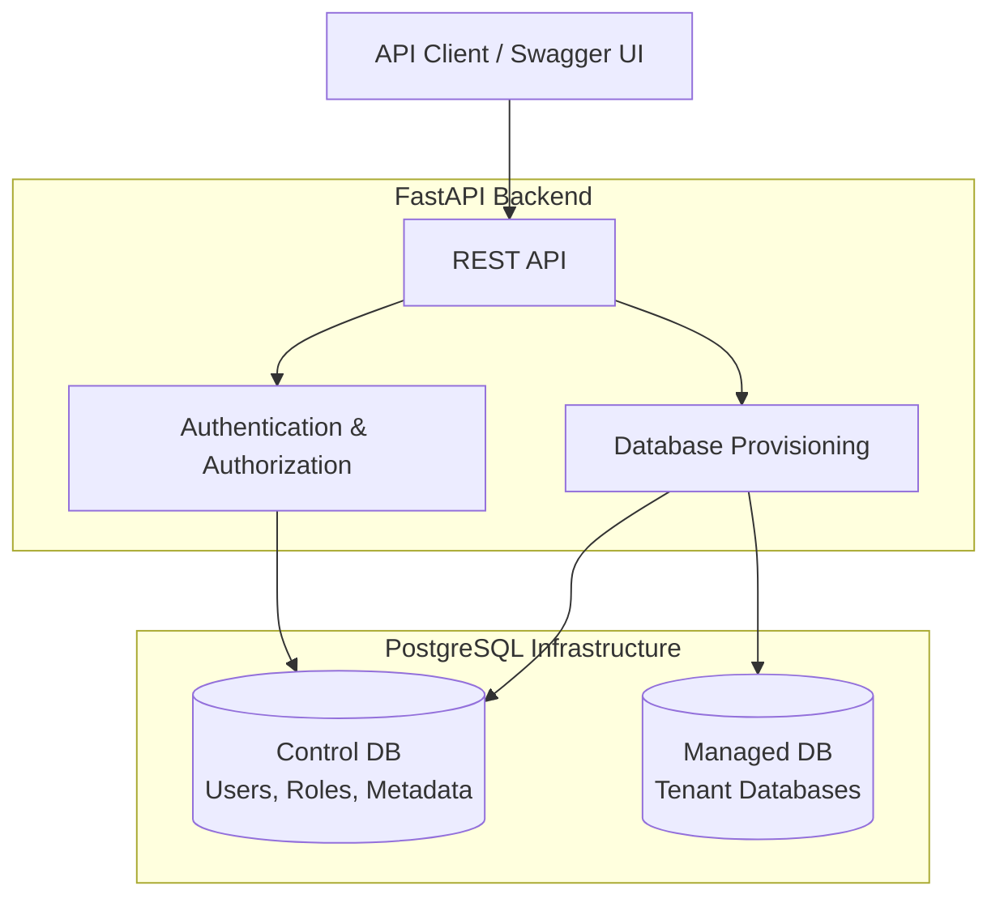
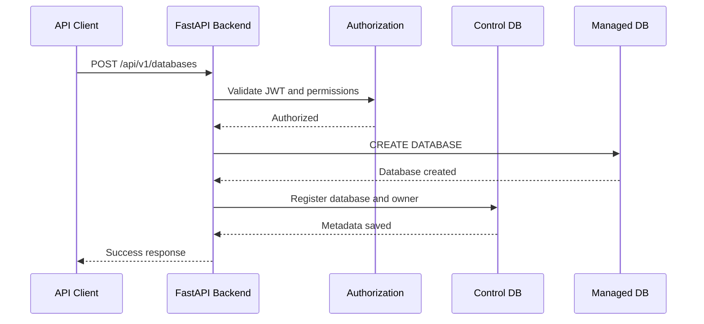
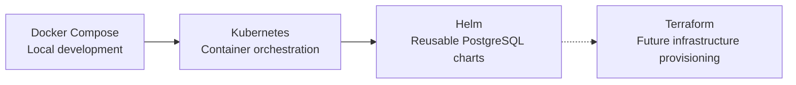

# Architecture Diagram

## High-level architecture

## Database provisioning flow

## Infrastructure evolution

## Notes

- Docker Compose is the initial and validated local deployment environment.
- Kubernetes manifests are available.
- Helm charts abstract PostgreSQL resources for the control and managed instances.
- Terraform is planned for future infrastructure provisioning.